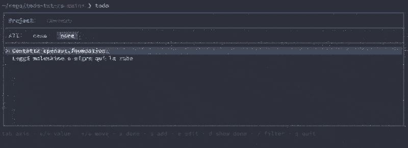

# todo-txt-rs



An inline terminal UI for [todo.txt](https://todotxt.org/). It reads and writes the same files as `todo.sh`, filters by project, context and priority, and keeps the todo directory in sync with git.

## Using it

- `←`/`→` (or `h`/`l`): change the value of the focused filter
- `tab` / `shift-tab`: focus Project, Context or Priority
- `↑`/`↓` (or `j`/`k`): move through the list
- `/`: filter the list by text (`enter` keeps it, `esc` clears it)
- `a`: add a todo, `e`: edit the selected one
- `x`: complete the selected todo, or restore a done one
- `d`: show or hide done items
- `q` (or `esc` with no filter): quit

The prompt on the bottom line takes the usual arrow, `home`, `end`, `backspace` and `delete` keys.

Filters only show the axes that have values. Project, Context and Priority tabs appear once the file has a `+project`, `@context` or `(A)` priority.

## Where it reads and writes

In order of precedence:

1. Environment variables `TODO_DIR`, `TODO_FILE` and `DONE_FILE`
2. `~/.todo/config` or `~/.todo.cfg`, the same files `todo.sh` uses
3. `~/.todo` is the default directory

If the todo file lives in a git repository, the app runs `git pull --rebase --autostash` when it starts. Every change is committed on its own (`todo: add ...`, `todo: done ...`, and so on), and the commit is pushed straight away.

### Install


## Requirements

- **`git`** on your `PATH`. The app calls `git` for the pull at startup and for every commit and push. The sync only happens when the todo directory is a git repository; otherwise the app works without `git`.
  - Linux and macOS: install `git` from your package manager or Xcode Command Line Tools.
  - Windows: install [Git for Windows](https://gitforwindows.org/) and make sure `git.exe` is on `PATH` (its installer offers this by default). Push over HTTPS uses Git Credential Manager, which Git for Windows includes.
- **A terminal with raw mode and ANSI support.** Windows Terminal or the classic console on Windows 10 and later.
- **Home directory:** `$HOME`, or `%USERPROFILE%` on Windows when `HOME` is unset. Config files and the default `.todo` directory are looked up there.

## Building with Nix

The build uses the `nixpkgs` pinned in `npins/`. No flakes are needed.

```sh
nix-build              # builds ./result/bin/todo
./result/bin/todo
```

### Without Nix

```sh
cargo build --release   # binary at target/release/todo
```

To install it on your `PATH`:

```sh
cargo install --path .  # installs ~/.cargo/bin/todo
```
